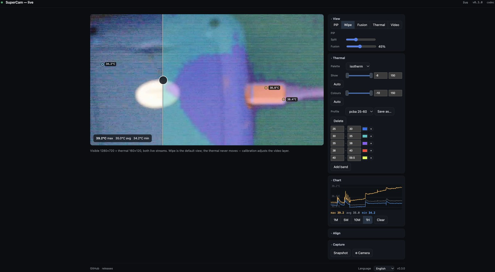

# SuperCam LC-AD11 — live view & thermal

Live video and thermal imaging from a **SuperCam LC-AD11** IP camera — sold as the
**QIANLI Super Cam LC-AD11**, the **SUNSHINE LC-AD11** and the **TB-03 V2.0**. One
camera, several badges: this project should work with any of them, in your browser,
**without the vendor app and without a Windows PC**.

Point it at your network and it finds the camera, connects, and serves a web GUI.



## Quick start

```bash
git clone https://github.com/flip555/qianli-supercam
cd qianli-supercam
docker compose up -d --build
```

Then open **`http://<docker-host>:8099/`** — it discovers the camera itself.

Prefer not to use Docker? You need Python 3.10+ and `ffmpeg`:

```bash
pip install -r requirements.txt
./run.sh start          # http://<host>:8099/
```

## What you get

* **No vendor software.** Talks the camera's own protocol directly — no Windows app, no VM.
* **Native 1080p visible feed**, decoded *in the browser* with WebCodecs, so the server
  does no video re-encoding at all. Browsers without WebCodecs — or a plain `http://`
  origin, since WebCodecs requires a secure context — fall back to a small
  server-side MJPEG transcode, which only runs while somebody is watching.
* **Thermal channel decoded** — 160×120, 16-bit — with rainbow / ironbow / white-hot /
  black-hot palettes, switchable live from the GUI and remembered across restarts.
* **Temperature readout** — max / average / min, with the hottest point, the coldest
  and up to two further peaks detected and labelled on the image.
* **Four view modes** — PiP, a draggable **wipe** comparison, or either feed
  full-frame. The chosen mode and split position are remembered.
* **Snapshot** — saves what you actually see: the current mode, split, calibration,
  temperature labels and readout, not just one raw feed.
* **Camera status at a glance** — the header dot shows live / connected-but-no-frames /
  searching, so a blank view is never ambiguous.
* **Camera settings** — read and write the camera's own network configuration and
  reboot it to apply, all from the GUI.
* **Auto-discovery** — finds cameras on the local network rather than needing a fixed
  IP, and backs off politely when the camera is missing.
* **Looks after itself** — the relay runs under a supervisor with a stall watchdog,
  and can update itself from GitHub releases without leaving the browser.

## Configuration

| Variable | Default | Purpose |
|---|---|---|
| `CAMERA_HOST` | `auto` | `auto` discovers on the LAN; or pin an address (`192.168.1.85`) |
| `CAMERA_CIDRS` | *(local /24s)* | Comma-separated ranges to sweep, e.g. `192.168.1.0/24` |
| `CAMERA_FALLBACK_CIDR` / `CAMERA_FALLBACK_IPS` | `192.168.1.0/24` / a few common addresses | Where a factory-fresh camera is looked for |
| `PORT` | `8099` | Web GUI port |
| `PALETTE` | `rainbow` | Default thermal palette (`rainbow`, `ironbow`, `whitehot`, `blackhot`) |
| `VIDEO_WIDTH` / `VIDEO_FPS` | `960` / `10` | Size and rate of the MJPEG fallback encode |
| `THERMAL_SCALE` / `THERMAL_OFFSET` | `0.01` / `0.0` | Absolute temperature calibration |
| `CALIBRATION_PATH` | `./calibration.json` | Where the image calibration is stored |
| `SUPERCAM_REPO` | `flip555/qianli-supercam` | Repository the updater reads releases from |

**Networking:** the bundled `docker-compose.yml` uses `network_mode: host` so
discovery can sweep your LAN and reach the camera. A bridged-network example is
included in the same file if you would rather set `CAMERA_HOST` explicitly.

## Finding cameras

```bash
python -m supercam.discover                      # local /24s
python -m supercam.discover --cidr 192.168.1.0/24 --json
```

Cameras listen on TCP 3001 (control) and 3000 (media); each one answers the probe
with its own name, which is how the relay identifies it.

## The web GUI

| Mode | What it shows |
|---|---|
| **Wipe** | Video with a draggable bar revealing the thermal — the easy way to calibrate (default) |
| **PiP** | Video with the thermal in a corner inset (three sizes) |
| **Thermal** | Thermal full-frame, with temperature labels |
| **Video** | Visible feed only |

Under the view: palette, PiP size, the wipe position, and the calibration sliders
(`Video scale`, `X`, `Y`, plus `Centre`). Calibration is stored server-side and
shared with every viewer. The header shows the running version — and turns into an
update link when a newer release is available — followed by a badge saying whether
this browser is decoding the feed itself (`codec`) or the relay is transcoding it
(`mjpeg`).

## Updating

Releases are tagged `vX.Y.Z` on GitHub and the version lives in
`supercam/__init__.py`. When a newer release is published, the version in the GUI
header becomes an update link: clicking it downloads that release, keeps a
timestamped backup of the current deployment beside it, installs the new files
(local state such as calibration, palette and the service script is preserved) and
restarts. A bad release can be rolled back by hand from the `.bak-<timestamp>`
directory.

## Translations

The GUI is translated from **`web/i18n/<lang>.json`** — one flat JSON file per
language, fetched at runtime, no build step. The picker in the footer remembers your
choice; on a first visit it follows the browser's own language.

Currently shipped: **English, Spanish, French, German, Portuguese**. The non-English
files were drafted with AI and are genuinely open to correction — if a phrase reads
wrongly to you, that is a useful contribution, not a nitpick.

Adding a language is one file plus a line in `LANGS` (in `web/index.html`):

```bash
cp web/i18n/en.json web/i18n/xx.json    # translate the values, keep the keys
```

Keys must match `en.json`; anything a translation omits falls back to the key name,
so a partial translation degrades rather than breaking.

## Contributing

Issues and pull requests are welcome — particularly notes or captures from other
units, since this was built against a single one (firmware
`0181_B001_V02.01.01.11`).

* `docs/PROTOCOL.md` documents the camera's control protocol, media framing and
  thermal encoding — enough to talk to one of these without this project.
* `relay.py` is the whole server. `supercam/` holds the camera client, thermal
  decoder, discovery, settings, reboot and updater. `web/index.html` is the entire
  GUI — one file, no build step.
* To cut a release: bump `supercam/__init__.py`, push to `main`, then publish a
  `vX.Y.Z` tag and release. Running copies will offer it in their header.
* Please keep the graceful paths: the WebCodecs feed must fall back to MJPEG, and a
  camera that cannot be found must never become a busy loop.

## Status & limitations

* WebCodecs needs a **secure context** (https, or localhost) and a browser with
  `VideoDecoder` — Chrome/Edge, or Safari 16.4+. Everything else uses the MJPEG
  fallback, which costs roughly half a core while somebody is watching.
* The camera's H.264 stream carries private NAL types; those are stripped before
  the browser sees it, which is why ffmpeg tolerates the stream and a strict
  decoder does not.
* Absolute thermal temperature is `raw/100`; verify the offset against a known
  reference before trusting absolute values.
* The visible and thermal lenses have different fields of view, so the wipe needs
  the one-off calibration above.
* Writing the camera's network settings works, but the unit here would not accept a
  change that moved it to a different `/24` — same-subnet changes apply normally.
  Moving subnets may need the vendor tool.
* Built and tested against **one** unit — a QIANLI Super Cam LC-AD11 on firmware
  `0181_B001_V02.01.01.11`. The same camera is sold as the SUNSHINE LC-AD11 and the
  TB-03 V2.0 and should behave identically, but those have not been tested here.
  Reports from other units (and other firmware revisions) are very welcome.
* The camera's own control interface has no authentication (a blank `root` password
  over telnet). Treat the relay, and the camera, as trusted-LAN only.

## Licence

MIT — see [LICENSE](LICENSE). Use it, fork it, sell it; just keep the copyright
notice. (The reverse-engineering notes in `docs/` describe this project's own work;
the camera firmware and the vendor app are not included or redistributed.)
